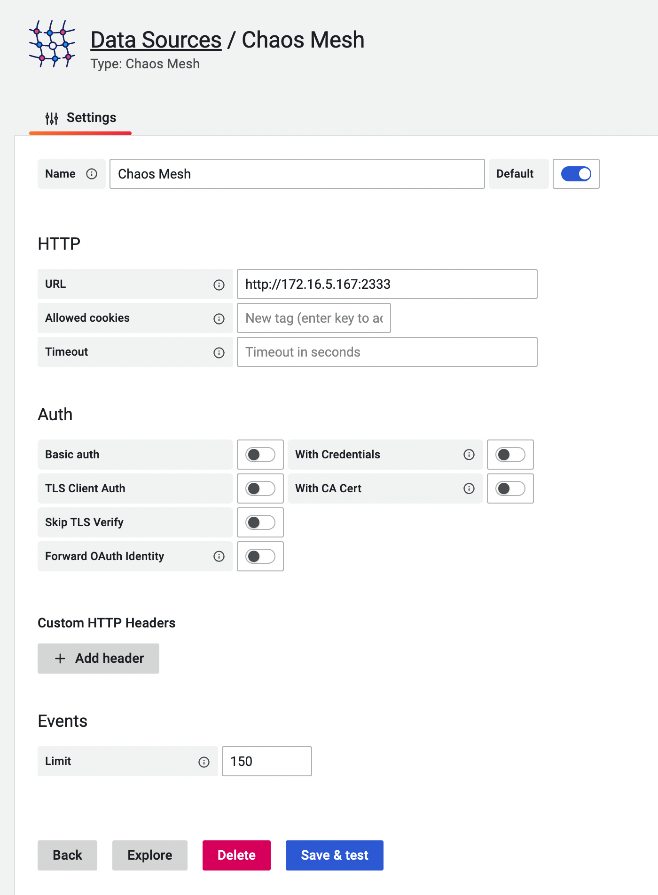
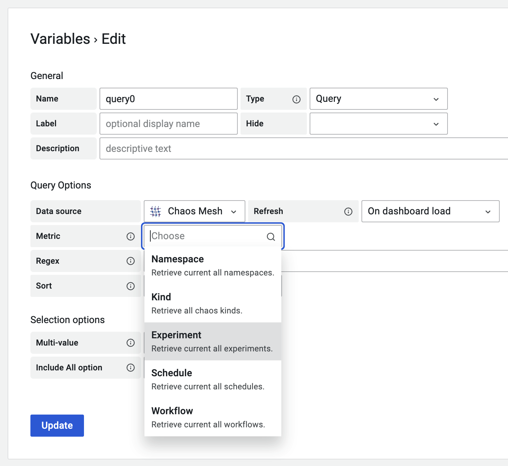
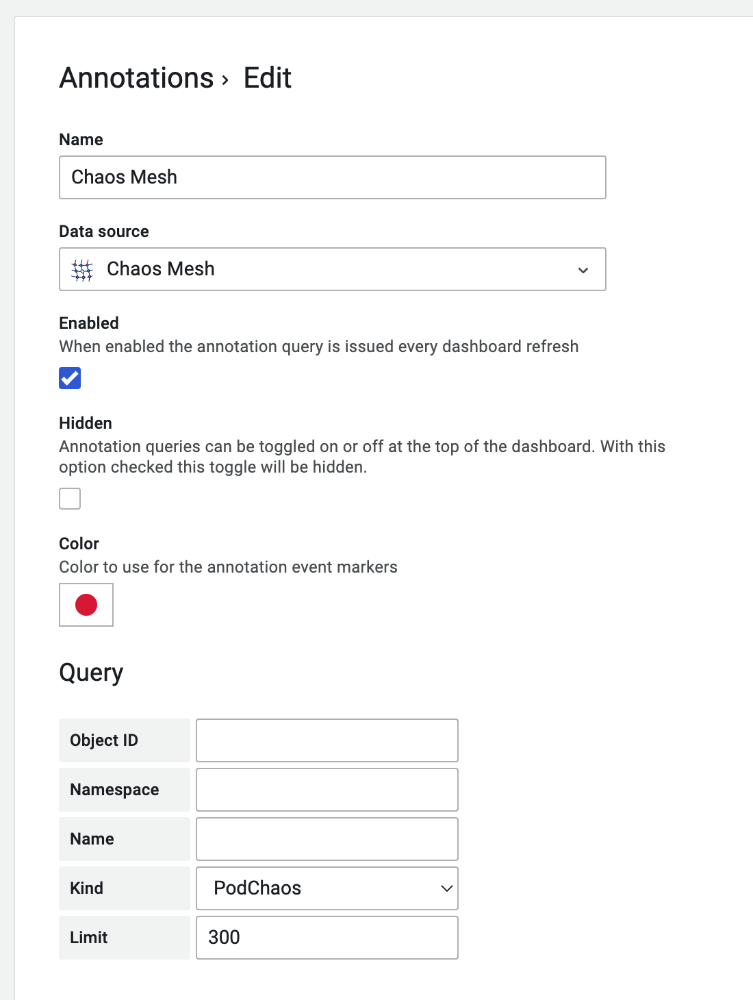

# Data Source

Grafana data source plugin for Chaos Mesh.

> Version 3.x of this plugin requires Chaos Mesh **2.1 or later** and Grafana **10.0.0 or later**.

## Features

- Displaying Chaos events in a table visualization
- Support [Variables](https://grafana.com/docs/grafana/latest/variables/) to filter Chaos events
- Support [Annotations](https://grafana.com/docs/grafana/latest/dashboards/annotations/) to annotate Chaos events on the panel

## Install

### With dashboard

[https://grafana.com/docs/grafana/latest/administration/plugin-management/#install-a-plugin](https://grafana.com/docs/grafana/latest/administration/plugin-management/#install-a-plugin)

### With cli

```sh
grafana-cli plugins install chaosmeshorg-datasource
```

## Manual installation

Choose a version compatible with your Grafana installation and download its ZIP file from [GitHub Releases](https://github.com/chaos-mesh/datasource/releases). Extract the ZIP into your Grafana plugins directory and restart Grafana.

### Local unsigned builds

To load a local unsigned build for development, add the following to `grafana.ini` before restarting Grafana.

```ini
[plugins]
allow_loading_unsigned_plugins = chaosmeshorg-datasource
```

## Setup

Once installed, go to **Administration -> Data sources** and add Chaos Mesh, then go to the configuration page:



Assuming you have Chaos Mesh installed locally, the Chaos Dashboard will export the API on port `2333` by default. So, if you haven't changed anything, you can fill in `http://localhost:2333`.

Then use the `port-forward` command to activate:

```shell
kubectl port-forward -n chaos-testing svc/chaos-dashboard 2333:2333
```

Finally, click **Save & test** to test the connection. If it shows a successful notification, the setup is complete.

## Query

The data source plugin looks at the Chaos Mesh through the lens of events, and the following options are responsible for filtering the different events:

- **Object ID**

  > Filter by object uuid.

- **Namespace**

  > Filter by different namespace.

- **Name**

  > Filter by object name.

- **Kind**

  > Filter by kind (PodChaos, NetworkChaos, Schedule...). You can also input an arbitrary kind
  > if you implement a new kind in Chaos Mesh.

- **Limit**

  > Set the maximum number of events to return.

Starting with plugin 3.1.0, on Chaos Mesh Dashboard 2.8.9 and later stable releases, each Grafana query sends all selected filter values in one `/api/events` request. The Dashboard returns the newest matching events first, and **Limit** applies to all matches for that query. Leave **Limit** blank for no limit, or set it to `0` to return no events.

On older Dashboard versions, the plugin sends one request per combination of selected filter values. **Limit** applies to each request.

## Variables

The data source plugin supports adding query variables by different metrics:



- **Namespace**

  > After selection, all available namespaces will show in the **Preview of values** directly.

- **Kind**

  > Same as **Namespace**. Retrieve all kinds.

- **Experiment/Schedule/Workflow**

  > Same as **Namespace**. Retrieve current all experiments/schedules/workflows.
  >
  > You can also specify the `queries` to further filter the values,
  > for example, `?namespace=default` will only retrieve the experiments/schedules/workflows in the `default` namespace.

## Annotations

You can integrate events into panels via annotations, the following is a sample creation, it will retrieve all PodChaos events:



Please refer to [Query](#query) to fill in the corresponding fields.

## How to contribute

Pull a request or open an issue to describe your changes or problems.

## License

Same as Chaos Mesh. Under the Apache-2.0 License.
